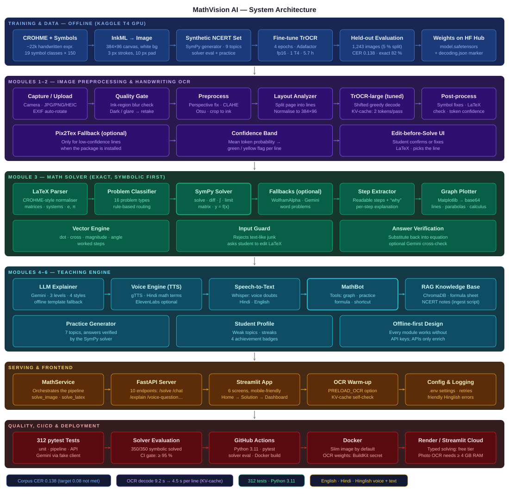
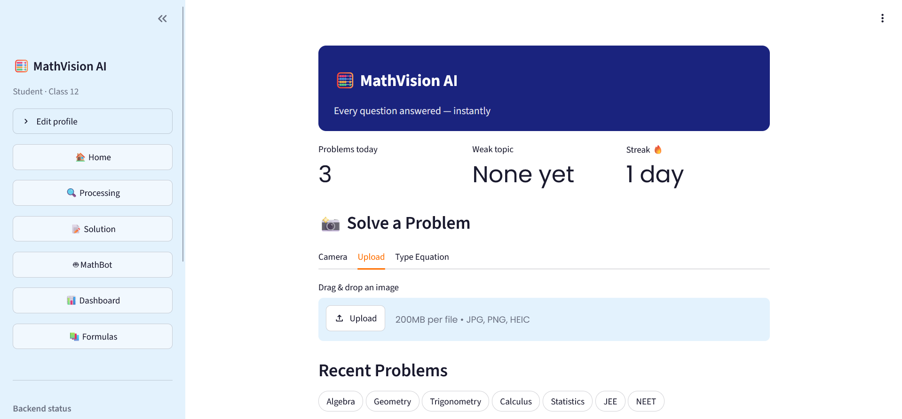
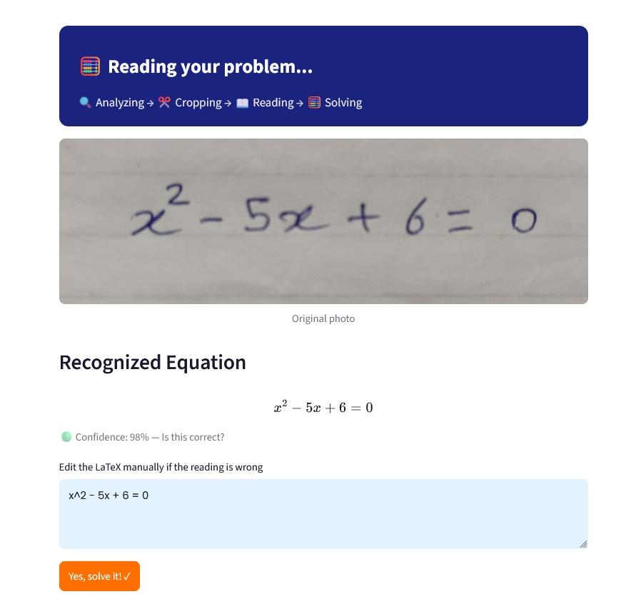
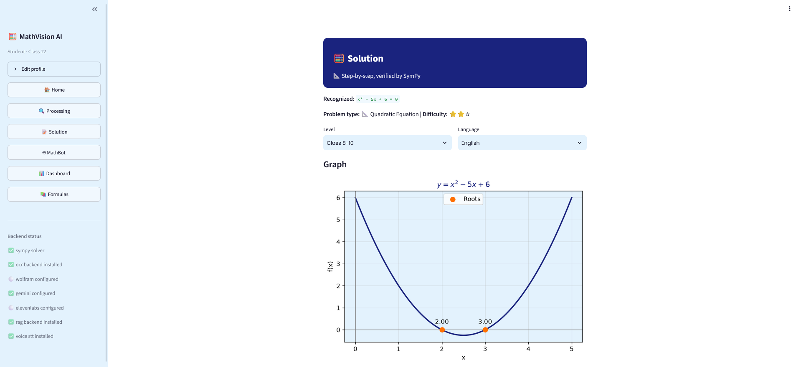
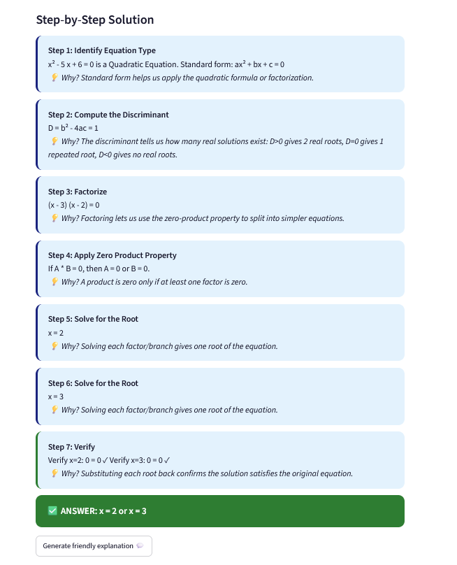
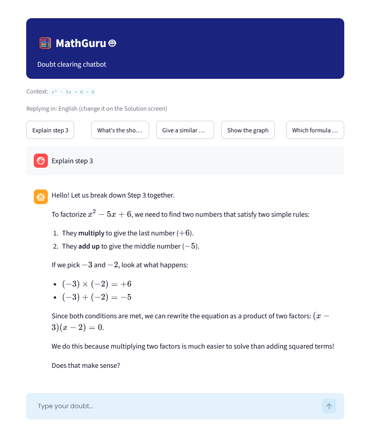
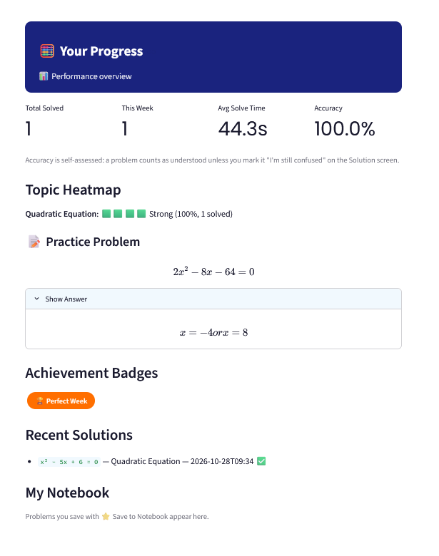
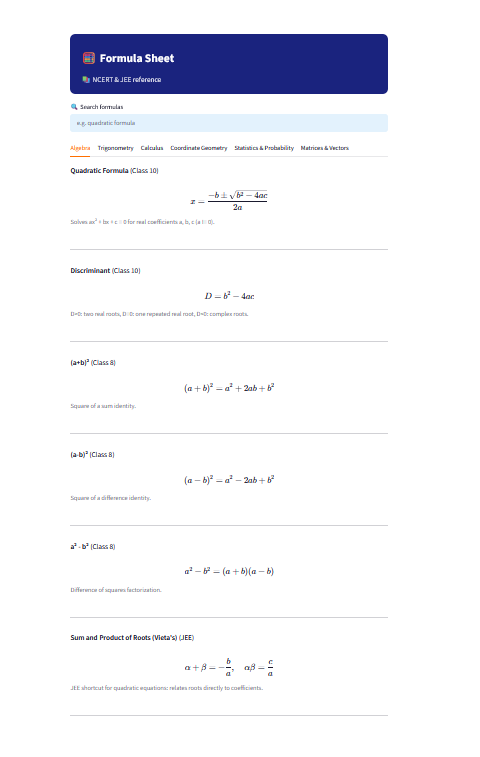
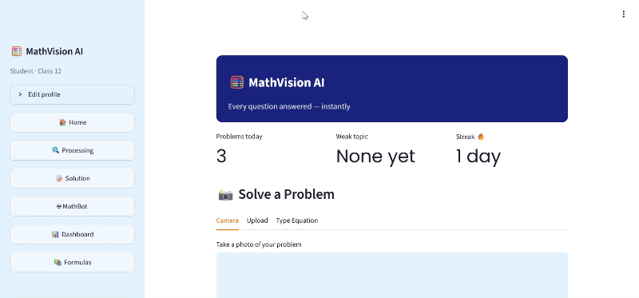

# 🧮 MathVision AI — Handwritten Math Problem Solver & Learning Assistant

[](https://github.com/narendrakalam2001/mathvision-ai/actions)
[](https://python.org)
[](tests/)
[](https://arxiv.org/abs/2109.10282)
[](https://www.sympy.org)
[](https://ai.google.dev)
[](https://fastapi.tiangolo.com)
[](https://streamlit.io)
[](https://huggingface.co/narendrakalam2001/trocr-math-ep4)
[](https://docker.com)
[](LICENSE)

> **Domain:** EdTech / Computer Vision / Symbolic AI  
> **Problem:** Read a *handwritten* maths problem from a photo → solve it exactly → explain every step (English / Hindi / Hinglish, text + voice) → clear follow-up doubts → track weak topics  
> **Dataset:** [CROHME handwritten expressions](https://www.kaggle.com/datasets/rtatman/handwritten-mathematical-expressions) · [Handwritten math symbols](https://www.kaggle.com/datasets/sagyamthapa/handwritten-math-symbols) · SymPy-generated NCERT-style problems  
> **Curriculum focus:** NCERT / CBSE Class 8–12 and JEE-style algebra, trigonometry, calculus, matrices and vectors  
> **Industry Context:** India's EdTech market is video-first (passive); doubt-solving from a *handwritten* photo, with step-by-step reasoning in the student's own language, is the gap this project targets

---

## 💡 Why This Project Matters

Students write on paper. Private tutors cost ₹500–2,000 per hour, and video lectures do not answer *"why did we calculate the discriminant in step 3?"*. MathVision AI is one pipeline that reads **their** handwriting, shows *why* each step is done (not just the answer), and explains it in a language they are comfortable with:

```
📸 photo → 🔍 quality check → ✂️ line split → 🖊️ handwriting OCR → 🧮 exact solve → 🪜 verified steps
        → 🗣️ explanation (EN / हिंदी / Hinglish) → 🔊 voice → 💬 doubt-clearing chat → 📊 weak-topic tracking
```

**Design decisions that make it trustworthy rather than a demo:**

| Decision | Why |
|---|---|
| **SymPy solves; the LLM never guesses core maths** | Answers are exact and verified (each quadratic ends with a "substitute back" check). Gemini only *explains* and handles word problems. |
| **OCR runs *before* the solver, and the student confirms it** | The recognised LaTeX is shown with a confidence band and an edit box — a misread symbol is fixed by the student, not silently solved wrong. |
| **Input guard** | Misread text (`yxx111--xx6600`) is refused with a "please edit the LaTeX" prompt instead of a confident nonsense answer. |
| **Every module works offline** | With no API keys the app still OCRs, solves, explains (template) and answers the suggested doubts. APIs only *enrich*. |
| **Two OCR backends, auto-selected** | Fine-tuned TrOCR when weights + torch are present (local); Gemini vision when they are not (small hosts such as Streamlit Cloud). |
| **Honest evaluation** | OCR missed its CER target (0.138 vs 0.08) — reported as is, with the known leakage caveat. |
| **Hermetic tests** | `tests/conftest.py` blanks API keys, so `pytest` never calls live APIs or burns quota, even with a real `.env`. |

---

## 🏆 Results

| Component | Metric | Value | Notes |
|---|---|---|---|
| **Handwriting OCR** (TrOCR-large, fine-tuned) | Corpus CER | **0.138** | Target < 0.08 **not met** |
| | Exact match | **82.1 %** | CROHME expressions 79.8 % · single symbols 100 % |
| | Test set | 1,243 images | Random 5 % split (see leakage caveat below) |
| **OCR speed** (KV-cache decoder) | Decode time, 10-token line | **9.19 s → 4.45 s** | 8-thread laptop CPU, encoder 2.53 s unchanged, output identical |
| **Symbolic solver** | Solved & routed correctly | **350 / 350** | Synthetic NCERT-style templates (regression guard, not a real-student benchmark) |
| **Solver speed** | 47 problems | **7.0 s total (~0.15 s each)** | Measured with `scripts/eval_solver.py` on CPU |
| **Problem types** | Recognised by the classifier | **16** | Linear → vectors, see [table](#-supported-problem-types); word problems need Gemini |
| **API** | Endpoints | **10** | FastAPI, OpenAPI docs at `/docs` |
| **Frontend** | Screens | **6** | Streamlit, covered by headless UI-flow tests |
| **Quality** | Automated tests | **326 passing** | No network, no API keys, no model weights needed (the 15 TrOCR-decoder tests additionally need `torch`) |
| **Languages** | Explanation + voice | **3** | English · हिंदी · Hinglish |

---

## 🔗 Live Links

| Service | URL |
|---|---|
| 🎓 **Student App — Lite (Streamlit Cloud)** | [https://mathvision-ai-lite.streamlit.app](https://mathvision-ai-lite.streamlit.app) |
| 💻 **GitHub Repository** | [narendrakalam2001/mathvision-ai](https://github.com/narendrakalam2001/mathvision-ai) |
| 🤗 **Fine-tuned OCR model** | [narendrakalam2001/trocr-math-ep4](https://huggingface.co/narendrakalam2001/trocr-math-ep4) |
| 📓 **EDA Notebook** | [notebooks/mathvision_ai_eda.ipynb](notebooks/mathvision_ai_eda.ipynb) |
| 🏋️ **Kaggle Training Notebook** | [notebooks/mathvision-ai-kaggle-training.ipynb](notebooks/mathvision-ai-kaggle-training.ipynb) |
| 📡 **API docs (local)** | `http://localhost:8000/docs` after `python scripts/run_api.py` |

> ⚠️ **Lite vs Full.** The fine-tuned TrOCR checkpoint is 2.2 GB and needs ≥ 4 GB RAM, so it cannot run on free hosting.
> The **Lite** app on Streamlit Cloud reads photos with **Gemini vision** instead (needs only `GEMINI_API_KEY`) — typed equations, steps,
> graphs, explanations, voice and chat work identically. The **Full** app (local / Docker) uses the fine-tuned TrOCR.
> Streamlit free apps sleep when idle: the first load can take 30–60 seconds.

---

## 🏗️ System Architecture



```
╔══════════════════════════════════════════════════════════════════════════════════════╗
║                      MATHVISION AI — 5-LAYER PRODUCTION SYSTEM                       ║
╠══════════════════════════════════════════════════════════════════════════════════════╣
║                                                                                      ║
║ ┌─ DATA LAYER ─────────────────────────────────────────────────────────────────────┐ ║
║ │ CROHME InkML + handwritten symbols + SymPy NCERT-style problems                  │ ║
║ │ InkML strokes → 384x96 images · ~22k expressions · 19 symbol classes x 150       │ ║
║ │ prepare_datasets.py → manifests · random 5% test split (1,243 images)            │ ║
║ └──────────────────────────────────────────────────────────────────────────────────┘ ║
║                                          ▼                                           ║
║ ┌─ TRAINING PIPELINE ──────────────────────────────────────────────────────────────┐ ║
║ │ microsoft/trocr-large-handwritten fine-tuned · 4 epochs · Adafactor · fp16       │ ║
║ │ batch 8 · lr 5e-5 · 5.7 h on one Kaggle T4 · decoding.json ships with weights    │ ║
║ │ Weights on HuggingFace Hub (2.2 GB) — never committed to git                     │ ║
║ │ RESULT: Corpus CER 0.138 · Exact match 82.1%  (target CER < 0.08 NOT met)        │ ║
║ └──────────────────────────────────────────────────────────────────────────────────┘ ║
║                                          ▼                                           ║
║ ┌─ SOLVER CORE — MathService (6 modules) ──────────────────────────────────────────┐ ║
║ │ [1] image_processor + layout_analyzer: EXIF · QC · CLAHE+Otsu · line split       │ ║
║ │ [2] OCR backend (auto): TrOCR local  |  Gemini vision (Lite, no weights)         │ ║
║ │ [3] latex_parser → classifier (16 types) → SymPy → Wolfram → Gemini → steps      │ ║
║ │ [4] llm_explainer: MathGuru · 3 levels · 4 styles · EN / Hindi / Hinglish        │ ║
║ │ [5] voice_engine: gTTS / ElevenLabs · Whisper speech-to-text                     │ ║
║ │ [6] mathbot + rag_engine: exact tools + Gemini grounded in the solution          │ ║
║ │ Input guard: misread LaTeX is refused, never answered with nonsense              │ ║
║ └──────────────────────────────────────────────────────────────────────────────────┘ ║
║                                          ▼                                           ║
║ ┌─ SERVING LAYER — FastAPI (10 endpoints) ─────────────────────────────────────────┐ ║
║ │ GET  /health         POST /solve (image → solution)   POST /solve/latex          │ ║
║ │ POST /explain        POST /explain/speak (MP3)        POST /chat                 │ ║
║ │ POST /voice-question GET  /practice/{topic}           GET  /student-profile      │ ║
║ │ POST /student-profile/attempt                                                    │ ║
║ └──────────────────────────────────────────────────────────────────────────────────┘ ║
║                                          ▼                                           ║
║ ┌─ STUDENT APP — Streamlit (6 screens) ────────────────────────────────────────────┐ ║
║ │ Home · Reading your problem (editable LaTeX) · Solution (steps, graph, voice)    │ ║
║ │ MathGuru chat · Your Progress (heatmap, streak, badges) · Formula Sheet          │ ║
║ │ Lite (Streamlit Cloud): photo via Gemini OCR · Full (local): fine-tuned TrOCR    │ ║
║ └──────────────────────────────────────────────────────────────────────────────────┘ ║
╚══════════════════════════════════════════════════════════════════════════════════════╝
```

*Edit `docs/architecture/generate_architecture.py` and run it to rebuild the SVG diagram — every label is overflow-checked.*

### Module-by-module data flow

```
Photo / Upload / Typed LaTeX
    │
    ▼
┌──────────────────────────────────────────────────────────────────┐
│ [1] image_processor.py + layout_analyzer.py                      │
│     EXIF rotate → blur / dark / glare QC → perspective fix →     │
│     CLAHE + Otsu → crop to ink → split into lines → normalise    │
│     every line to the 384×96 training canvas                     │
└──────────────────────────────────────────────────────────────────┘
    │
    ▼
┌──────────────────────────────────────────────────────────────────┐
│ [2] OCR backend — chosen automatically by MathService            │
│     weights + torch present → ocr_engine.py                      │
│        TrOCR-large (fine-tuned, shifted-label greedy decoding    │
│        with a KV-cache) → optional Pix2Tex fallback              │
│     else GEMINI_API_KEY set → gemini_ocr.py (Gemini vision)      │
│     both → symbol-confusion fixes → LaTeX validation → confidence│
└──────────────────────────────────────────────────────────────────┘
    │
    ▼
┌──────────────────────────────────────────────────────────────────┐
│ [3] latex_parser → problem_classifier → math_solver →            │
│     step_extractor (+ vector_ops, graph_plotter)                 │
│     CROHME-style LaTeX normaliser → 16 problem types → SymPy →   │
│     (optional) WolframAlpha / Gemini → numbered steps with "why" │
└──────────────────────────────────────────────────────────────────┘
    │
    ▼
┌──────────────────────────────────────────────────────────────────┐
│ [4] llm_explainer.py   MathGuru persona · 3 levels · 4 styles ·  │
│     English / Hindi / Hinglish · step translation                │
│ [5] voice_engine.py    gTTS (ElevenLabs optional) · Whisper STT ·│
│     maths spoken as words ("x squared equals 4")                 │
│ [6] mathbot.py + rag_engine.py   exact tools (graph, practice,   │
│     formula, shortcut) + Gemini grounded in the verified         │
│     solution and ChromaDB notes                                  │
└──────────────────────────────────────────────────────────────────┘

Side systems: problem_generator.py (SymPy-verified practice problems) ·
              student_profile.py (heatmap, streaks, badges, notebook)
```

---

## 📸 App Screenshots

### 🏠 Student Portal — Home

Camera, upload or typed equation · live counters (**Problems today**, **Weak topic**, **Streak**) · recent problems with a working subject filter.



---

### 🔍 Reading Your Problem — OCR with human-in-the-loop

The handwriting is recognised, rendered as maths, shown with a confidence band, and the student can **edit the LaTeX before solving**. Photos with several lines let the student pick which one to solve.



---

### 📝 Solution — type, difficulty, level & language

Problem type and difficulty, **Level** (Class 8–10 / 11–12 / JEE) and **Language** selectors, and a graph with the roots marked.



---

### 🪜 Step-by-Step Solution — every step says *why*

Verified steps (identify → discriminant → factorise → zero-product → roots → **substitute-back check**) and a highlighted answer. Changing the language re-renders the steps.



---

### 💬 MathGuru's Explanation — level- and language-aware

Friendly explanation with common mistakes, a memory trick and a practice problem, regenerated when the level or language changes.

| | |
|---|---|
|  |  |

---

### 🤖 MathGuru — doubt-clearing chat

Suggested-doubt chips (explain step, shortcut, similar problem, graph, formula) answered by exact tools; free-form doubts go to Gemini, grounded in the verified solution and the formula knowledge base. Offline fallback when no key is set.



---

### 📊 Your Progress — dashboard

Total solved · this week · average solve time · self-assessed accuracy · topic heatmap · weak-topic alert with an inline practice problem · badges · recent solutions · notebook.



---

### 📚 Formula Sheet

NCERT / JEE reference in six tabs (algebra, trigonometry, calculus, coordinate geometry, statistics & probability, matrices & vectors) with LaTeX rendering and search.



---

## 🎬 System Demo



---

## 📁 Project Structure

```
mathvision-ai/
│
├── src/                                    # Core modules
│   ├── config.py                           # Settings from .env (frozen dataclass)
│   ├── image_processor.py                  # QC, perspective, CLAHE/Otsu, crop
│   ├── layout_analyzer.py                  # Line splitting + training-style normalisation
│   ├── ocr_engine.py                       # TrOCR (shifted decoding + KV-cache), Pix2Tex fallback
│   ├── gemini_ocr.py                       # Weights-free OCR via Gemini vision (Lite mode)
│   ├── latex_parser.py                     # CROHME-style LaTeX → SymPy
│   ├── problem_classifier.py               # 16 problem types
│   ├── math_solver.py                      # SymPy → Wolfram → Gemini, input guard
│   ├── vector_ops.py                       # Dot / cross / magnitude / angle with steps
│   ├── step_extractor.py                   # Numbered steps with "why"
│   ├── graph_plotter.py                    # Matplotlib → base64 PNG
│   ├── math_text.py                        # LaTeX → readable text / spoken text
│   ├── gemini_client.py                    # One place for model name, retries, errors (text + image)
│   ├── llm_explainer.py                    # MathGuru explanations + step translation
│   ├── voice_engine.py                     # gTTS / ElevenLabs, Whisper
│   ├── rag_engine.py                       # ChromaDB formula knowledge base
│   ├── mathbot.py                          # Tools + grounded Gemini chat
│   ├── problem_generator.py                # SymPy-verified practice problems
│   └── student_profile.py                  # Streaks, heatmap, badges, notebook
│
├── services/
│   └── math_service.py                     # Orchestration layer used by API and app · OCR backend selection
│
├── serving/
│   └── api.py                              # FastAPI: 10 endpoints
│
├── frontend/
│   ├── app.py                              # Streamlit app (6 screens)
│   └── requirements.txt                    # Lean dependencies for Streamlit Cloud (Lite)
│
├── scripts/
│   ├── prepare_datasets.py                 # InkML / symbol folders → image + label manifests
│   ├── train_ocr.py                        # TrOCR fine-tuning
│   ├── generate_problems.py                # Synthetic NCERT-style dataset
│   ├── eval_solver.py                      # Solver accuracy check (used in CI)
│   ├── ingest_knowledge.py                 # Build the ChromaDB index
│   ├── download_model.py                   # Fetch fine-tuned weights from the HF Hub
│   ├── check_ocr.py · benchmark_ocr.py     # OCR sanity check + speed benchmark
│   └── run_api.py · run_app.py             # Launchers
│
├── notebooks/
│   ├── mathvision_ai_eda.ipynb             # Exploratory data analysis
│   └── mathvision-ai-kaggle-training.ipynb # Kaggle GPU: TrOCR-large fine-tuning (CROHME + symbols)
│
├── data/
│   ├── knowledge_base/formula_sheet.json   # 26 NCERT / JEE formulas in 6 categories
│   ├── raw/ · processed/ · ncert_problems/ # Datasets — git-ignored, regenerated by scripts
│   └── student_profiles/                   # Runtime learner data — git-ignored
│
├── models/
│   └── trocr_finetuned/                    # Weights are DOWNLOADED from HF Hub, never committed
│
├── sample_problems/                        # Demo photos (photo1.jpeg, photo2.jpeg, test1.png)
│
├── tests/                                  # 326 pytest tests (23 files + conftest.py)
│
├── docs/
│   ├── architecture/                       # architecture.svg + generator script
│   ├── screenshots/                        # UI screenshots used in this README
│   └── gifs/User_Portal.gif                # Walkthrough
│
├── .streamlit/config.toml                  # Theme + student-friendly toolbar
├── Dockerfile                              # FastAPI production image
├── .github/workflows/ci.yml                # GitHub Actions — tests, solver gate, Docker build
├── render.yaml                             # Render.com blueprint (API only)
├── .gitignore · .dockerignore · .env.example
├── requirements.txt                        # Full dependencies (local / Docker)
├── pytest.ini
├── LICENSE                                 # MIT License
└── README.md                               # This file
```

---

## 🚀 Quickstart

### 1. Clone & Install

```bash
git clone https://github.com/narendrakalam2001/mathvision-ai.git
cd mathvision-ai
python -m venv venv && source venv/bin/activate        # Windows: venv\Scripts\activate
pip install torch --index-url https://download.pytorch.org/whl/cpu   # CPU-only, smaller
pip install -r requirements.txt
cp .env.example .env                                   # Windows: copy .env.example .env
```

### 2. Add Keys (all optional)

`GEMINI_API_KEY` unlocks the LLM explanations, Hindi/Hinglish step translation, grounded chat **and the Lite photo OCR**.
`WOLFRAMALPHA_APP_ID` and `ELEVENLABS_API_KEY` are optional extras. Without any key the app runs fully offline (typed equations, template explanations, local TrOCR).
The Gemini model name lives in `.env` (`GEMINI_MODEL`) because Google retires models regularly.

### 3. Download the OCR Weights (2.2 GB — Full mode only)

```bash
python scripts/download_model.py          # public HF repo — no token needed
python scripts/check_ocr.py sample_problems/photo1.jpeg --preprocess   # sanity check
```

The model repo [`narendrakalam2001/trocr-math-ep4`](https://huggingface.co/narendrakalam2001/trocr-math-ep4) is **public**, so no HuggingFace token or login is required. Weights land in `models/trocr_finetuned/` (git-ignored). Skip this step to run in Lite mode — the app then uses Gemini vision for photos.

### 4. Build the Knowledge Base

```bash
python scripts/ingest_knowledge.py       # formula sheet → ChromaDB (downloads a small embedding model once)
```

### 5. Start API and App

```bash
python scripts/run_api.py                # terminal 1 → http://localhost:8000/docs
streamlit run frontend/app.py            # terminal 2 → http://localhost:8501
```

The Streamlit app talks to `MathService` directly, so it also works **without** the API running.

### 6. Check the Solver

```bash
python scripts/eval_solver.py --count 450 --min-solve-rate 0.95
```

Expected output (last line):
```
SYMBOLIC: 350/350 solved = 100.0%
```

Word-problem topics (coordinate-geometry and probability word templates) are listed as "needs Gemini" and excluded from the symbolic score.

### 7. Run Tests

```bash
pytest                                   # ~1 min, no API keys or weights needed
# 326 tests · 311 run without torch · the 15 TrOCR-decoder tests are skipped when torch is missing
```

### 8. Train Your Own OCR Model (optional, needs a GPU)

Easiest: open [`notebooks/mathvision-ai-kaggle-training.ipynb`](notebooks/mathvision-ai-kaggle-training.ipynb) on Kaggle (free T4 GPU). Or run the scripts locally:

```bash
python scripts/prepare_datasets.py --data-root /path/to/downloaded/datasets   # InkML → images + labels
python scripts/train_ocr.py --epochs 4 --batch-size 8 --lr 5e-5
```

---

## ☁️ Deployment

| Target | What runs | Photo OCR | How |
|---|---|---|---|
| **Streamlit Cloud (Lite)** | `frontend/app.py` + `frontend/requirements.txt` | Gemini vision | Main file `frontend/app.py` · Python 3.11 · Secrets: `GEMINI_API_KEY`, `GEMINI_MODEL` |
| **Local (Full)** | Streamlit app + FastAPI | Fine-tuned TrOCR | Quickstart steps 1–5 |
| **Docker (Full)** | FastAPI image | TrOCR when built with `DOWNLOAD_MODEL=1` | See below |

Streamlit Cloud secrets (TOML):

```toml
GEMINI_API_KEY = "your_key"
GEMINI_MODEL = "gemini-3.1-flash-lite"
```

No `HUGGINGFACE_TOKEN` is needed anywhere — the model repo is public, and on Streamlit Cloud the 2.2 GB model is never downloaded at all.

---

## 🐳 Docker

```bash
docker build -t mathvision-ai .                          # solver / chat / explanations (small image)
docker run -p 8000:8000 --env-file .env mathvision-ai    # API + /health check

# with the OCR weights baked in (host with ≥ 4 GB RAM)
echo "$HF_TOKEN" > hf_token.txt
DOCKER_BUILDKIT=1 docker build --build-arg DOWNLOAD_MODEL=1 --secret id=hf_token,src=hf_token.txt -t mathvision-ai:ocr .
```

The token is passed as a BuildKit secret, so it never ends up in an image layer.

| Service | URL |
|---|---|
| FastAPI + Swagger | `http://localhost:8000/docs` |
| Health check | `http://localhost:8000/health` |

---

## 🌐 API Reference

| Method | Endpoint | Purpose |
|---|---|---|
| `GET` | `/health` | Which backends are installed / configured (incl. active `ocr_backend`) |
| `POST` | `/solve` | **Image → solution** (multipart `file`, optional `line_index`) |
| `POST` | `/solve/latex` | LaTeX → solution |
| `POST` | `/explain` | Solution steps → level/language-aware explanation |
| `POST` | `/explain/speak` | Explanation → MP3 |
| `POST` | `/chat` | MathBot doubt clearing (`language`: english / hindi / hinglish) |
| `POST` | `/voice-question` | Audio question → Whisper → answer |
| `GET` | `/practice/{topic}` | SymPy-verified practice problem |
| `GET` | `/student-profile` | Heatmap, streak, badges, recent, notebook |
| `POST` | `/student-profile/attempt` | Record an attempt |

### POST /solve/latex — Solve a Typed Problem

```bash
curl -X POST http://localhost:8000/solve/latex \
  -H "Content-Type: application/json" -d '{"latex": "x^2 - 5x + 6 = 0"}'
```

**Response:**
```json
{
  "latex": "x^2 - 5x + 6 = 0",
  "problem_type": "quadratic_equation",
  "classification_confidence": 0.95,
  "answer": "x = 2 or x = 3",
  "steps": [
    {"number": 1, "title": "Identify Equation Type",
     "content": "x^{2} - 5 x + 6 = 0 is a Quadratic Equation. Standard form: ax^2 + bx + c = 0",
     "why": "Standard form helps us apply the quadratic formula or factorization.", "verified": false},
    {"number": 2, "title": "Compute the Discriminant", "content": "D = b^2 - 4ac = 1",
     "why": "The discriminant tells us how many real solutions exist: ...", "verified": false}
  ],
  "difficulty": 2,
  "engine_used": "sympy",
  "graph_base64": "data:image/png;base64,iVBORw0K..."
}
```

*(5 more steps omitted — zero-product property, both roots and a substitute-back verification.)*

### POST /solve — Photo → Solution

```bash
curl -X POST http://localhost:8000/solve -F "file=@sample_problems/photo1.jpeg"
```

Returns the same fields as `/solve/latex` plus `quality` (blur / brightness check) and `ocr`
(`latex`, `confidence`, `confidence_band`, `engine_used` = `trocr` | `pix2tex` | `gemini`, and all detected `lines`).
A blurry photo returns `retake_recommended: true`; readable-but-unsolvable text returns `solve_error` so the UI can show the edit box.

### POST /chat — Doubt Clearing

```json
{ "session_id": "demo", "message": "What's the shortcut?",
  "problem_latex": "x^2 - 5x + 6 = 0", "language": "english" }
```

```json
{ "text": "JEE trick: Vieta's formulas!\nSum of roots = -b/a = 5\nProduct of roots = c/a = 6\nFaster than full factorization — verify by checking sum & product match!",
  "graph_base64": null, "source": "local_fallback" }
```

`source` is `local_fallback` for exact tools and `gemini` for grounded free-form answers.

### GET /practice/vectors

```json
{ "topic": "Vectors", "class_level": "Class 12",
  "latex_problem": "\\text{Find the angle between } \\vec{a} \\text{ and } \\vec{b} \\text{ for } \\vec{a}=(2, 4, 2), \\vec{b}=(4, 0, -4)",
  "latex_answer": "\\theta = \\frac{\\pi}{2} \\approx 90.00^\\circ", "difficulty": 2 }
```

### GET /health

```json
{"status": "ok", "sympy_solver": true, "ocr_backend": "gemini", "gemini_configured": true,
 "rag_backend_installed": false, "voice_stt_installed": false}
```

---

## 🧮 Supported Problem Types

| Type | Example | Engine |
|---|---|---|
| Linear equations | `2x + 3 = 7` | SymPy |
| Quadratic equations | `x² − 5x + 6 = 0` | SymPy (+ Vieta's shortcut in MathBot) |
| Simultaneous equations | `2x + 3y = 12, x − y = 1` | SymPy |
| Polynomials | `x³ − 6x² + 11x − 6 = 0` | SymPy |
| Two-variable relations & graphs | `y = 2x + 3`, `y = x² − 4x + 3` | SymPy + Matplotlib (slope, intercepts, vertex) |
| Trigonometry | `sin²x + cos²x`, `sin x + cos x = 1` | SymPy |
| Differentiation / integration / limits | `d/dx(x³)`, `∫ eˣ dx`, `lim sin x / x` | SymPy (`+ C` for indefinite integrals) |
| Matrices | `[[3,4],[1,2]]` — determinant, product | SymPy |
| **Vectors** | dot, cross, magnitude, unit vector, angle, sum / difference — `(1,2,3)·(4,5,6)`, `2î − ĵ + 3k̂` | SymPy, worked steps |
| Arithmetic & simplification | `√49`, `sin²x + cos²x` | SymPy |
| Word problems | "A train travels…" | Gemini (API key required) |

**Solver routing:** `SymPy` (exact) → `WolframAlpha` (optional, free tier ≈ 2,000 queries/month) → `Gemini` (word problems and verification). The classifier picks the route; SymPy is always tried first.

---

## 📊 OCR Backends — Comparison

| Backend | Runs where | Weights / RAM | Measured accuracy | Used when |
|---|---|---|---|---|
| **TrOCR-large (fine-tuned)** ⭐ | Local / Docker with ≥ 4 GB | 2.2 GB · ≥ 4 GB RAM | **CER 0.138 · EM 82.1 %** | `models/trocr_finetuned/` + `torch` present |
| **Pix2Tex** (fallback) | Local | optional `pix2tex` package | not benchmarked here | TrOCR output invalid / low confidence |
| **Gemini vision** (Lite) | Streamlit Cloud / any small host | none · tiny RAM | not benchmarked here | no weights, `GEMINI_API_KEY` set |

> The backend is chosen automatically by `MathService.ocr_backend_name()` (`local` → `gemini` → `none`), and the active choice is reported by `GET /health`.
> Gemini returns no per-symbol probabilities, so its confidence is a heuristic (0.80 for balanced/valid LaTeX, 0.30 otherwise) — the student still confirms the reading before solving.

---

## 🔬 OCR — Fine-tuned TrOCR-large

**Training:** `microsoft/trocr-large-handwritten` fine-tuned on CROHME (InkML pen strokes rendered to 384×96 images, ~22k expressions) plus handwritten math symbols (19 classes × 150). 4 epochs, Adafactor, fp16, effective batch 8, **5.7 h on one Kaggle T4**.

| Subset | n | Corpus CER | Exact match |
|---|---:|---:|---:|
| CROHME expressions | 1,101 | **0.139** | **79.8 %** |
| Single symbols | 142 | 0.000 | 100 % |
| **Overall** | **1,243** | **0.138** | **82.1 %** |

> **Honest notes**
> * The `CER < 0.08` target was **not met** (0.138). CER = total edit distance ÷ total reference characters.
> * CROHME repeats expressions across competition years and the split is random, so exact match is probably **optimistic** (train/test leakage).
> * A 4-photo spot check on real paper (not a benchmark): `y = 2x + 3` ✅ · `x² − 5x + 6 = 0` with a raised exponent ✅ · `x^2` written with a caret `^` ✗ ✗ — the model learned CROHME's raised-exponent style, not the caret glyph.

### ⚡ KV-Cache Decoding

The checkpoint needs a custom decoding loop (next section), so the first version re-ran the whole decoder prefix at every step. The current decoder uses a key/value cache and exploits that the token fed at position *k* is `P[k-2]` — already known — so it consumes **two tokens per forward pass**.

| Check | Result |
|---|---|
| Correctness | Cached == reference token-for-token (probabilities within 1e-4) on random TrOCR-style models: 12 seeds × 5 lengths + EOS cases; identical on the real checkpoint |
| Decode, 10-token line, 8-thread CPU | **9.19 s → 4.45 s** (encoder 2.53 s unchanged) — decoder alone ≈ 6.7 s → 1.9 s |
| Safety net | `warm_up()` compares both decoders on a blank image and disables the cache if they ever disagree; a failing cache call falls back to the reference path |

### 🐛 The Bug That Cost One Training Run

After the first 5.7 h run, validation CER stayed above 1.0 while the loss fell to 0.085. Teacher-forced decoding was near-perfect (CER 0.007) but `generate()` produced loops — a train/inference mismatch. With `transformers` 4.5x the labels were shifted **twice** (once into `decoder_input_ids`, once inside the causal-LM loss), so the model learned to predict token *k+1* from position *k*. The weights were fine: decoding with the matching `[<s>, <s>, P0, P1, …]` alignment (`decoding.json` ships with the weights) dropped CER from **0.99 to 0.14**. A retrain should compute the loss explicitly.

---

## 🛡️ Confidence & Input Guard — 3-Band Trust System

Unlike a "read it and solve it" pipeline, MathVision AI treats the OCR result as a *proposal* the student confirms:

| Band | Confidence | UI behaviour |
|---|---|---|
| 🟢 **Green** | ≥ 0.60 | Shown as recognised — one click to solve |
| 🟡 **Yellow** | 0.35 – 0.60 | "Verify" — edit box highlighted |
| 🔴 **Red** | < 0.35 | Likely wrong — student is asked to edit the LaTeX |

| Guard | Trigger | Effect |
|---|---|---|
| **Image quality** | Laplacian blur variance < 30 · brightness < 40 or > 235 | "Please retake — image too blurry / dark / bright" — OCR is skipped |
| **LaTeX validation** | Unbalanced braces / brackets after OCR | Low confidence + review flag; Pix2Tex fallback when installed |
| **Input guard** | Text SymPy cannot make sense of (`yxx111--xx6600`) | Refused with "please edit the LaTeX" — **never** forwarded to an LLM for a guess |
| **Multi-line photo** | Several expressions detected | Student picks the line to solve (`line_index`) |

> **Why a guard?** A confident wrong answer to a misread equation teaches a student the wrong thing. Refusing and asking for a correction costs one tap; a wrong "verified" solution costs trust.

All thresholds are configurable from `.env` (`OCR_CONFIDENCE_THRESHOLD`, `OCR_LOW_CONFIDENCE_THRESHOLD`, `BLUR_VARIANCE_THRESHOLD`, `MIN_BRIGHTNESS`, `MAX_BRIGHTNESS`).

---

## 🎓 Learning Features

| Feature | Details |
|---|---|
| **Levels** | Class 8–10 · Class 11–12 · JEE / Advanced |
| **Styles** | Standard · visual · story · shortcut |
| **Languages** | English · हिंदी · Hinglish — text and voice. The UI is English; the *Language* selector re-renders the steps and the explanation (Hindi/Hinglish needs `GEMINI_API_KEY`; otherwise English stays, with a note) |
| **Voice** | gTTS (free) or ElevenLabs; maths is spoken as words (`x squared equals 4`), Hindi math terms for Hindi/Hinglish; Whisper for voice doubts |
| **MathBot** | Exact tools (graph, practice problem, formula, shortcut) + Gemini answers grounded in the verified solution and ChromaDB notes |
| **Practice** | SymPy-verified similar problems (7 topics); "Start a practice problem" for your weakest topic |
| **Formula Sheet** | 26 NCERT / JEE formulas across 6 categories, searchable, LaTeX-rendered |

### How the Student Stats Work

Every solved problem is counted automatically when its solution is shown (Home counters, streak, recents, dashboard). **Accuracy is self-assessed**: a problem counts as understood unless the student presses **🤔 I'm still confused**, which makes the topic a *weak topic*. **⭐ Save to Notebook** is a separate bookmark list. Profiles are stored in `data/student_profiles/` (git-ignored; override with `STUDENT_PROFILE_DIR`).

---

## 📈 Student App — 6 Screens

| Screen | What it shows |
|---|---|
| **1. Home / Camera** | Camera · upload · typed equation · today's counters · streak · recent problems · subject filter |
| **2. Reading Your Problem** | Original photo · quality check · recognised LaTeX with confidence band · edit box · line picker |
| **3. Solution** | Problem type · difficulty · level + language selectors · graph · numbered steps with "why" · answer box · listen / practice / doubt / notebook actions |
| **4. MathGuru Chat** | Context-aware doubt clearing · suggested-doubt chips · voice question |
| **5. Your Progress** | Total / weekly / average time · self-assessed accuracy · topic heatmap · weak-topic alert · badges · notebook |
| **6. Formula Sheet** | Six subject tabs · LaTeX rendering · search |

---

## 🧪 Test Coverage

**326 tests · no network, no API keys, no model weights** (the 15 TrOCR-decoder tests additionally need `torch`).

| Area | Tests | Highlights |
|---|---:|---|
| Parsing, solver, vectors, steps, text helpers | 135 | CROHME-style LaTeX (`\frac 1 x`, `\begin {pmatrix}`), 16 problem types, dot/cross/angle, readable + spoken maths |
| OCR & image pipeline | 65 | blur/glare QC, line splitting, **cached decoder ≡ reference decoder**, InkML dataset builders, **Gemini OCR backend (14)** |
| Teaching & learning | 51 | Gemini client (fake client, retries, retired-model message), grounded MathBot, profile, notebook, self-assessment |
| API & service | 35 | endpoints, step translation, chat language, errors that must never reach an LLM |
| Frontend flows | 28 | headless `AppTest`: stats update, notebook, language switch, English-only UI, dashboard practice |
| Engineering guards | 12 | every script launches from any directory; no Python-3.12-only syntax (CI runs 3.11) |

**CI (GitHub Actions):** pytest with coverage · solver evaluation gate (≥ 95 % symbolic) · synthetic-data smoke test · OCR training dry run · Docker build + a `/health` smoke test of the built image.

---

## 🧠 Technical Standards

| Component | Implementation |
|---|---|
| **OCR model** | `microsoft/trocr-large-handwritten` fine-tuned on CROHME + symbols (HF Hub: `trocr-math-ep4`) |
| **Decoding** | Shifted-label greedy decoding with KV-cache (2 tokens per forward pass) — 9.19 s → 4.45 s |
| **Solver** | SymPy exact solving → WolframAlpha (optional) → Gemini; 16 problem types; verified steps |
| **LLM** | Gemini via one wrapper (`gemini_client.py`): retries with back-off; "model not found" / "bad key" not retried |
| **Preprocessing** | EXIF rotate · perspective fix · CLAHE · Otsu · morphological cleanup · line segmentation |
| **Voice** | gTTS / ElevenLabs (TTS) · Whisper (STT) · maths spoken as words |
| **RAG** | ChromaDB + sentence-transformers over the NCERT / JEE formula sheet |
| **Type hints + docstrings** | On all public functions |
| **Configuration** | Frozen settings dataclass from `.env`; no secrets in code; `.env` git-ignored |
| **Failure containment** | A failed graph, translation or LLM call never breaks the solution screen |
| **Reproducibility** | Fixed seeds, pinned `transformers>=4.46,<5`, `decoding.json` marker travels with the weights |
| **Test isolation** | API keys blanked and profiles redirected to a temp dir for the whole test session |
| **Security** | HF token passed as a BuildKit secret; personal learning data and weights git-ignored |
| **CI/CD** | GitHub Actions — pytest · solver gate · Docker build + health smoke test |
| **Deployment** | Streamlit Cloud (Lite, Gemini OCR) · Docker / local (Full, TrOCR) |

---

## 📊 Business Impact

Figures marked *(assumption)* come from the project brief, not from a measurement in this repository.

| Metric | Value |
|---|---|
| Private maths tutor cost | **₹500 – 2,000 per hour** *(assumption)* |
| Photo → solution, local CPU | **≈ 7 s OCR** (encoder 2.53 s + decode 4.45 s, 10-token line) **+ ≈ 0.15 s solve** — measured |
| Photo → solution, Lite (Gemini OCR) | Network-bound; not benchmarked here |
| Cost to the student | **Free**, open source, self-hostable — Gemini free tier optional |
| Curriculum coverage | NCERT / CBSE Class 8–12 + JEE-style topics, 16 problem types |
| Languages | English · हिंदी · Hinglish (text + voice) |
| Doubt clearing | Context-aware chat grounded in the exact solution on screen |
| Target users | School students preparing for boards / JEE / NEET *(assumption: India-wide — not piloted)* |

> Positioning: not a tutor replacement — a 24×7 first line of doubt-clearing that tells the student **why** each step is done, so tutor time is spent on harder concepts.

---

## 🆚 How MathVision AI Differs

Established doubt-solving apps already read handwriting (since 2016) and work offline, so those are **not** claimed as differentiators. What this project focuses on:

| Focus | MathVision AI |
|---|---|
| Indian curriculum (NCERT / CBSE / JEE) | Class 8–12 levels, JEE shortcut tricks (Vieta's formulas), NCERT/JEE formula sheet |
| Language | Explanations and steps in English / हिंदी / Hinglish, with voice |
| Doubt clearing | Chat that is **grounded in the exact solution the student is looking at** |
| Transparency | Verified, numbered steps with a *why* for each; human-in-the-loop LaTeX editing |
| Learning loop | Weak-topic detection → targeted, SymPy-verified practice |
| Ownership | Open source and self-hostable; works without any paid API |

---

## 🛡️ Limitations & Ethical Considerations

* **Not a replacement for a teacher.** The student's confirmation of the recognised LaTeX is a deliberate step; always check the reading before trusting the answer.
* The OCR `CER < 0.08` target was **not met** (0.138), and the random CROHME split makes exact match probably optimistic (train/test leakage).
* Exponents must be written raised (x²); a `^` caret is misread by the fine-tuned TrOCR. One expression per line — stacked equations or multi-row matrices may be split (the UI lets the student pick or edit the line).
* **Lite mode (Gemini OCR) has not been benchmarked** — its accuracy on real handwriting was not measured, and it sends the cropped photo to Google's API. Do not upload photos containing personal student data.
* Not supported yet: parametric quadratics (`ax² + bx + c = 0`), general trigonometric solutions (only principal values), vector projections / triple products, diagram-based geometry.
* English word problems (distance, probability) need the Gemini fallback and an API key.
* Real paper photos are harder than the synthetic training renders; accuracy on them was only spot-checked.
* Gemini features were tested with a fake client, not exercised against the live API in CI. Free-tier Gemini inputs may be used by Google to improve its products.
* The fine-tuned OCR model needs ≥ 4 GB RAM and therefore cannot run on free hosting.

---

## 🗺️ Roadmap

- Retrain with the label-shift fix (removes the custom decoding loop); batch several lines per forward pass
- Benchmark Gemini-vision OCR against the fine-tuned TrOCR on real handwritten photos
- Parametric quadratics, general trigonometric solutions, vector projections / triple products
- Diagram-based geometry; Physics and Chemistry
- Offline (TFLite / ONNX) model for low-connectivity use
- Mobile app (React Native) and a teacher dashboard with class analytics
- School ERP integration

---

## 👨‍💻 About

**Narendra Kalam** — MSc Computer Science (Gold Medalist — NASSCOM, Full Stack Data Science + AI)

> Building 30+ industry-level, end-to-end ML systems across all domains.

[](https://www.linkedin.com/in/narendra-kalam)
[](https://www.kaggle.com/narendrakalam)
[](https://narendrakalam2001.github.io)
[](mailto:kalamnarendra2001@gmail.com)

### Portfolio Projects

| # | Project | Domain | Champion Model | Key Metric |
|---|---|---|---|---|
| 1 | Credit Card Fraud Detection | BFSI / Fintech | ExtraTrees | F1 = 0.8962 · 284K transactions |
| 2 | Credit Risk Prediction | BFSI / Lending | LightGBM | F1 = 0.9741 · ROC-AUC = 0.9991 |
| 3 | Customer Churn Prediction | Telecom / BFSI | CatBoost | F1 = 0.634 · Recall = 0.7312 |
| 4 | House Price Prediction | Real Estate | CatBoost | RMSE = $20,128 · R² = 0.9053 |
| 5 | Store Sales Forecasting | Retail / Supply Chain | LightGBM (Ensemble) | RMSLE = 0.3739 · R² = 0.9761 |
| 6 | Energy Demand Forecasting | Energy / Utilities | ElasticNet | RMSE = 712.04 MW · R² = 0.9759 |
| 7 | Stock Price & Risk Forecasting | Fintech / Capital Markets | Ridge | DirAcc = 53.44% · Sharpe = 0.80 |
| 8 | Resume Screener AI | HR Tech | LightGBM | F1 = 0.7608 · Top-3 = 0.9416 |
| 9 | ABSA Sentiment Analysis | E-Commerce / Banking | RidgeClassifier | Macro-F1 = 0.6212 · ROC-AUC = 0.823 |
| 10 | Fake News Detector | Media Tech / Gov Tech | XGBoost | F1 = 0.9993 · ROC = 1.0000 |
| 11 | BC5CDR Clinical NER | Biomedical NLP | BioBERT | F1 = 0.8847 · Chemical F1 = 0.9239 |
| 12 | News Topic Modeling | Media Analytics | LDA (Gensim) | Cv = 0.6225 · Diversity = 0.92 |
| 13 | Chest X-Ray Diagnosis | Healthcare AI | DenseNet121 | Mean AUC = 0.7864 · 14 classes |
| 14 | Real-Time Object Detection | Computer Vision / Retail-Security | YOLOv8s | mAP50-95 = 0.5341 · 32 FPS |
| 15 | Face Emotion Recognition | EdTech / Retail CX | CNN-from-scratch | Macro-F1 = 0.5950 · 7 classes |
| 16 | Customer Segmentation Engine | E-Commerce / BFSI | DBSCAN (Unsupervised) | Silhouette = 0.4056 |
| 17 | Market Basket Analysis (Instacart) | Retail / Quick-Commerce | Apriori | 68,820 rules · mean lift = 15.66 |
| 18 | E-Commerce / OTT Recommender | E-Commerce / Streaming | Hybrid (SVD + Content) | NDCG@10 = 0.0407 · 4 candidates |
| 19 | Hospital Readmission Prediction | Healthcare / Hospital Ops | ExtraTrees | F1 = 0.2702 · ROC-AUC = 0.6513 |
| 20 | HR Policy Intelligence Chatbot | HR Tech / Enterprise GenAI | Gemini 3.6 Flash + RAG | 30/30 tests · guardrail threshold=0.35 |
| 21 | Employee Attrition Prediction | HR Tech / People Analytics | NeuralNet (MLP) | F1 = 0.3902 · ROC-AUC = 0.6698 |
| 22 | ANN From Scratch — MNIST Digit Recognizer | Deep Learning Fundamentals | From-scratch ANN | Test Acc = 0.9740 · Macro F1 = 0.9739 |
| 23 | Insurance Premium Prediction | Insurance / Actuarial ML | RandomForest | RMSLE = 1.1586 · 1.2M real policies |
| 24 | Health Insurance Cross-Sell | Insurance / BFSI | ExtraTrees | ROC-AUC = 0.8404 · 67.8% calls saved |
| 25 | Ride Fare Price Prediction | Mobility / Ride-Hailing | LightGBM | RMSE = $3.81 · R² = 0.8419 · 55M rows |
| 26 | E-Commerce BI & SQL Analytics | Retail Analytics / BI | SQL + FastAPI + Streamlit | 40 tests passing · 100K orders |
| 27 | AgriSense AI | AgriTech | EfficientNetB3 | Accuracy = 98.44% · Macro-F1 = 0.9843 · 38 classes |
| 28 | AI Loan Underwriting Platform | BFSI / Fintech | XGBoost (credit + fraud) | Credit ROC-AUC = 0.858 · Fraud ROC-AUC = 0.955 · 242 tests |
| 29 | CineMatch Pro | Entertainment / Media Tech | Hybrid SVD + TF-IDF + SBERT · CLIP · RoBERTa | RMSE = 0.8005 · Sentiment Acc = 94.26% · 56K posters |
| 30 | DriveGuard AI | Computer Vision / Smart Cities | YOLOv8m + DeepSORT + Gemini RAG | mAP@0.5 = 0.680 · 31 API routes · 364 tests |
| 31 | **MathVision AI** | **EdTech / Computer Vision** | **TrOCR-large + SymPy** | **CER = 0.138 · 350/350 symbolic solved** |

---

## 📚 References

- Li et al. (2021) — [TrOCR: Transformer-based Optical Character Recognition with Pre-trained Models](https://arxiv.org/abs/2109.10282)
- Mouchère et al. — ICDAR **CROHME** competitions on recognition of online handwritten mathematical expressions (TC-11)
- Meurer et al. (2017) — [SymPy: symbolic computing in Python](https://peerj.com/articles/cs-103/)
- Radford et al. (2022) — [Robust Speech Recognition via Large-Scale Weak Supervision (Whisper)](https://arxiv.org/abs/2212.04356)
- Reimers & Gurevych (2019) — [Sentence-BERT](https://arxiv.org/abs/1908.10084) (embeddings used for the formula knowledge base)
- Datasets: [CROHME on Kaggle](https://www.kaggle.com/datasets/rtatman/handwritten-mathematical-expressions) · [Handwritten math symbols on Kaggle](https://www.kaggle.com/datasets/sagyamthapa/handwritten-math-symbols)

---

## 📄 License

MIT License — see [LICENSE](LICENSE)
